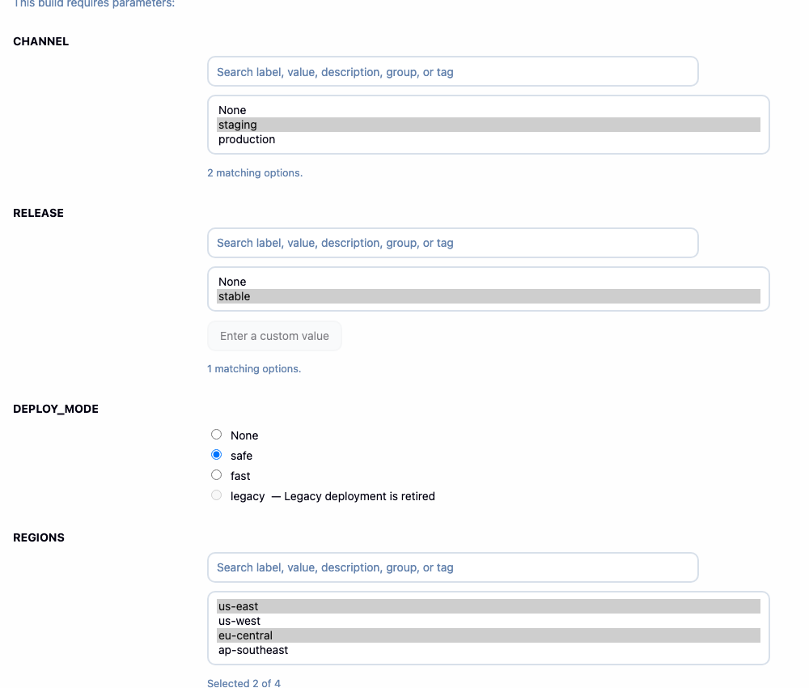
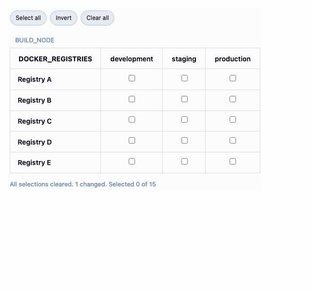
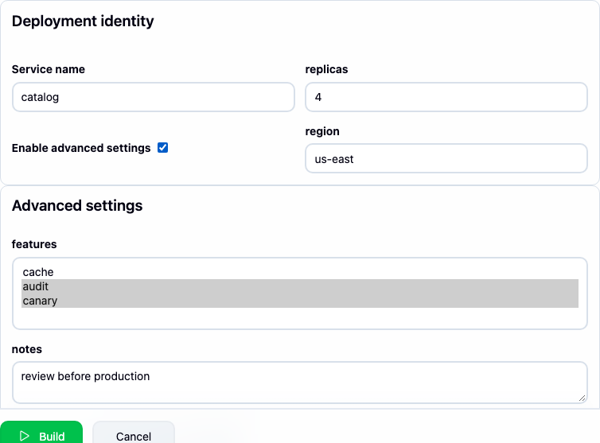
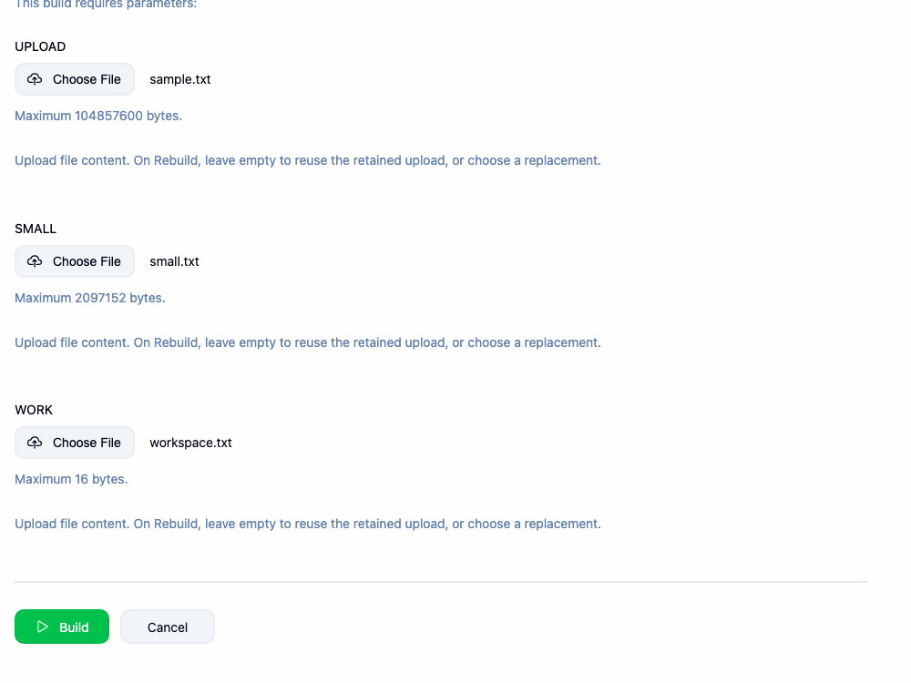
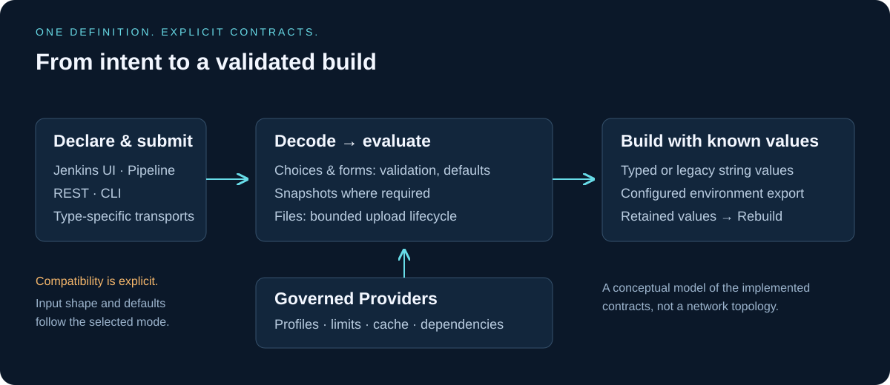
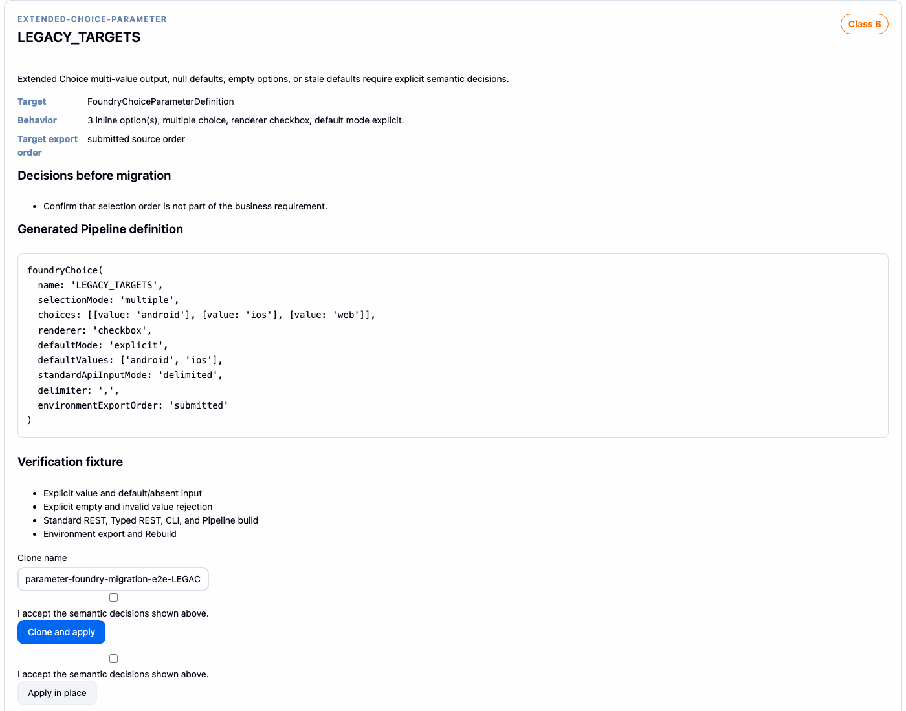
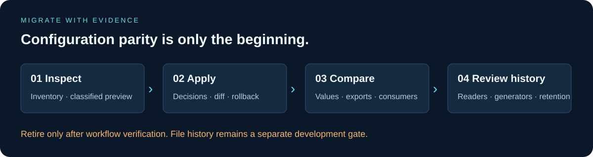
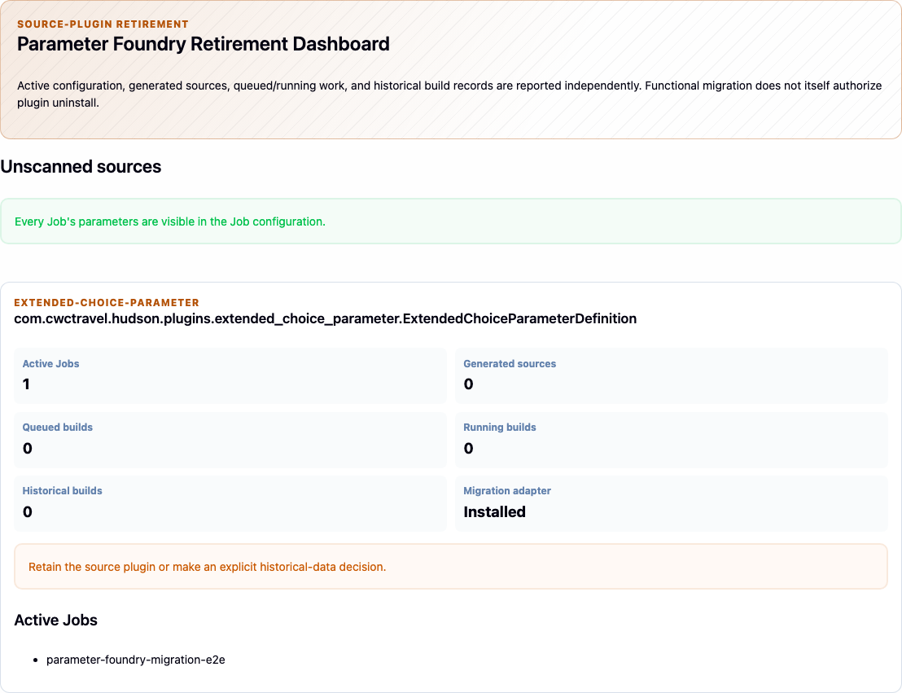

# Feature overview

**Explore the interface. Follow the value. Review the evidence.**

The visuals below combine real Jenkins captures with explicitly labeled conceptual
diagrams. Click an image to inspect it at full resolution. [Sources and reproduction](../media/README.md).

This page inventories the implemented public surface from the `1.27`
source line, retained in the `1.28` hosting preparation. It separates ordinary parameter behavior, explicit legacy
compatibility, and opt-in history readers. Field-level details remain in the
linked guides and Jenkins inline help.

The repository is public; Jenkins community hosting and update-center publication
are pending. Build from source using the [README](../../README.md#build-and-install).
Roadmap labels in older design documents are milestones, not published version numbers.

## Parameter types and Pipeline helpers

| Symbol | Purpose | Values or delivery |
|---|---|---|
| `foundryChoice` | Single, multiple, or matrix selection | String/null or canonical list; explicit legacy modes can retain strings |
| `foundryForm` | Related typed fields validated together | Map or JSON string |
| `foundryReference` | Sanitized literal HTML presentation | Independent Core string value; ordinary browser submission is empty |
| `foundryFile` | Unified file upload | `workspace`, `base64`, or `stash` |
| `foundryBase64File` | Compatible dedicated Base64 entry | Base64 value/environment export |
| `foundryStashedFile` | Compatible dedicated stash entry | Build-owned file/stash delivery |
| `withFoundryFileParameter` | Bind an uploaded file inside a build step | Workspace destination or scoped temporary path, depending on delivery mode |
| `foundryParameterText` | Read the current build's saved parameter string | Exact supported literal, with optional `fallbackIfMissing` |

See [parameter types](./parameters.md), [file parameters](./file-parameters.md),
and [saved parameter text](./pipeline-parameter-text.md).

## Choices, matrices, and presentation

*Actual Jenkins controls, cropped from the synthetic UI Lab. Disabled options and
selection constraints are enforced on the server as well as in the browser.*

- Single selection: dropdown, searchable selector, list, or radio group.
- Multiple selection: list, checkbox group, or table, with optional selected-value
  chips and bounded display of long selections.
- Options: stable machine values, labels, descriptions, groups, tags, disabled
  state, and disabled reasons. Labels do not define identity.
- Validation: required values, explicit/first/no default, minimum and maximum
  selection counts, duplicate policy, and validated custom single values.
- Matrices: rows, columns, and selectable cells; missing cells are unavailable.
  Matrix Providers add cell templates and `any`, `at-most-one`, or `exactly-one`
  rules per row. Row/column shortcuts and bulk actions honor those rules.
- List sizing: `visibleItemCount` controls display rows without limiting options
  or selections.
- UI tools: YAML/JSON option import preview, native no-JavaScript fallbacks,
  responsive controls, and the bundled `accessible-choice-grid` renderer.
- Localization: migration and retirement interfaces and their diagnostic messages
  include English, Chinese, Japanese, and Korean resources. This is not a claim
  that every third-party or Jenkins Core interface is translated.

Reference content is literal sanitized HTML. Dynamic reference scripts and
arbitrary custom HTML widgets are not silently migrated into that capability.

## Shared Providers

*A shared row/column model becomes selectable build values. This real interaction
sequence selects a column, combines a row, selects all, then inverts.
[Static matrix](../media/matrix.png) · [Provider configuration](./providers.md).*

Providers live in global or Folder configuration, with explicit nested-Folder
visibility. A parameter references a Provider by ID; `dependsOn` supplies its
reactive inputs.

| Provider symbol | Source or composition |
|---|---|
| `foundryStaticProvider` | Centrally maintained option list |
| `foundryNodeProvider` | Jenkins agents, labels, or built-in-first configured node order |
| `foundryMappingProvider` | Declarative dependency value → options cases and default options |
| `foundryMatrixProvider` | Inline or Provider-backed row/column axes and cell templates |
| `foundryManagedConfigProvider` | Config File Provider content, with parsing and path mapping |
| `foundryRestProvider` | Governed HTTP responses, mapped options, and reviewed source response modes |
| `foundryGitRefProvider` | Branches, tags, or refs, filtering, ref limits, and configured sort order |
| `foundryScriptProvider` | Reviewed script catalog entry through a declared engine |

Supporting configuration includes `foundryConnectionProfile`,
`foundryProfileHeader`, `foundryRestQuery`, `foundryTransform`,
`foundryMappingCase`, and `foundryScriptCatalogEntry`.

Provider runtime controls include cache TTL, request budgets, in-flight sharing,
bounded results, transforms, declared fallback options and failure policies,
last-known-good age limits, and health reporting. Dependency refresh validates
bindings and uses option snapshots where the selected transport requires them.
Changing a definition can invalidate an old snapshot.

Git sorting supports ascending, descending, smart variants, and unsorted source
category behavior. A zero cache TTL retries a failed Git lookup on the next
request. Legacy full-ref naming, combined categories, ordering, and literal
API defaults still need source-specific comparison.

See [Providers](./providers.md) for scope, permissions, configuration, and limits.

## REST response choices

REST Providers support mapped responses and reviewed data-only Active Choices
ordinary/cascade JSON interpretation. These modes preserve defined source
metadata and UI/API distinctions without executing the source Groovy script.

The separate whole-response mode can preserve exact UTF-8 response text as one
choice, with ordered trailing literals, exact sentinels, and explicitly declared
failure choices. It supports finite DNS/TLS failure declarations, an opt-in
nonredirect body status policy, and separately authorized finite same-origin
redirect destinations with a shared deadline and final-request failure matching.

These are restricted, reviewed modes rather than arbitrary HTTP execution.
TLS verification stays enabled; raw whole-response transport is credential-free.
Use `foundryRawLiteral` and `foundryRawFailureChoice` for its data configuration.
See [Whole-response REST choices](./raw-rest-responses.md).

## Structured forms

*The advanced panel appears after its controlling checkbox is enabled. The capture
script verifies that the replica count is stored as an integer.*

Forms support `string`, `text`, `integer`, `decimal`, `boolean`, `choice`,
`multi-choice`, `date`, `time`, `content`, `object`, and `array` fields.
`foundryFormField` defines fields; `foundryFormLayout` defines sections, grids,
tabs, and conditional layouts.

Constraints cover required values, defaults, string lengths/patterns, numeric
ranges, array sizes, and item types. Nested schema configuration is available
through code-based configuration. Secret fields are masked in presentation and
excluded from environment export. Whole-form JSON export and per-field variables
are configurable; hiding a layout is presentation, not an authorization rule.

## File delivery and lifecycle

*Real upload controls from the file-delivery acceptance scenario. The displayed
limits are fixture-specific overrides; consult the defaults below.*

Workspace delivery places the upload at a validated workspace-relative path.
Freestyle places it before build steps; Pipeline uses the wrapper in an allocated
workspace. Base64 delivers small content through a string/environment value;
stash delivery supports `unstash` and wrapper-based access.

Default decoded limits are 1 MiB for Base64 and 100 MiB for workspace/stash;
positive `maxUploadBytes` values override them. Ingestion rejects invalid paths
and oversized data. Queue cancellation, rejected submissions, crash-orphan
cleanup, build retention, download permissions, and reuse in Rebuild are covered
by the file lifecycle. Changing delivery modes requires a replacement upload.

File bytes use browser/REST multipart or the documented CLI content transport.
Typed JSON rejects Jobs with binary definitions. Base64 also supports small
Pipeline downstream values and `input`; workspace/stash are not mid-build upload
transports. File content is not unpacked or executed by the plugin.

See [File parameters](./file-parameters.md) for permissions and retention limits.

## Automation and value contracts

*Architecture illustration. Each entry point uses the selected transport contract;
the diagram does not imply identical input shapes for all types.*

Configuration is available through Jenkins UI, Pipeline, optional Job DSL, and
JCasC. Provider definitions belong to global/Folder configuration, not arbitrary
Pipeline step calls. Use Jenkins' Snippet Generator or the Job DSL reference for
the appropriate syntax; closure-based Job DSL and Pipeline named arguments differ.

| Entry point | Contract |
|---|---|
| Browser, standard REST, CLI | Validate through the selected parameter transport; compatibility modes intentionally preserve source-specific literals |
| Typed JSON API | `schema`, `resolve`, `validate`, `build`, `providers/health`, `import/preview` under the Job's `parameter-foundry/api/v1/` path |
| Pipeline and downstream builds | Typed ordinary values or explicitly selected legacy strings; separate file helpers |
| Environment | Configured string/delimited/JSON export, ordering rules, and form-field exclusions |
| Rebuild | Historical defaults and retained Foundry file reuse, subject to current definitions and supported history types |

Stable error codes distinguish invalid values, stale snapshots, unsupported
definitions, and request limits. `foundryParameterText` reads stored supported
strings without resolving Providers, evaluating defaults, or reading overridden
environment variables. It excludes sensitive and binary values.

## Legacy transport compatibility

| Source mode | Implemented behavior and boundary |
|---|---|
| Extended Choice | Static single/multiple transports, literal defaults, source empty-token and empty-option distinctions, duplicate UI entries, source export order, and editable string history; optional Core string storage for static multiple choices |
| Active Choices | Single/multiple string transports, independent API defaults, reviewed regex/no-filter and refresh policies, governed reactive Providers, JSON response interpretation, and literal reference presentation |
| List Git Branches | Literal revision submission, independent dropdown/API defaults, source selection/filtering behavior, advisory Git listing, and editable historical strings |

Ordinary typed values remain strict. A compatibility mode is not a general
promise that every script, filter, fallback, default, or historical workflow is
equivalent. See [Parameter reference](./parameters.md#input-decoding) and the
source contracts linked from [Migration](./migration.md).

## Migration and plugin retirement

*An archived synthetic migration preview illustrates the review workflow; it is
not a recommendation to copy this generated definition for an unrelated Job.*

Adapters cover 14 source families: Extended Choice, Active Choices, List Git
Branches, Custom Checkbox, Editable Choice, Extensible Choice, HTML Parameters,
JSON Editor, JSON Parameter, Multiselect, REST List, Validating String,
File Parameters, and Jenkins Core File.

The workflow provides inventory, A/B/C/D classification, explicit decisions,
configuration diffs, generated definitions, apply/clone, atomic per-Job batches,
rollback with change detection, and recorded before/after build evidence.
CLI commands are `parameter-foundry-migration` and
`parameter-foundry-migration-verify`. Read-only replacement simulation compares
recorded values/exports; the retirement dashboard inventories remaining references.

Scripts are never executed during migration. Jenkinsfile-declared parameters
must change at their source, multibranch/generated configuration needs separate
review, and binary lifecycle parity requires manual verification.

## History readers and extension boundaries

*The retirement report makes remaining references visible. A clean configuration
scan alone does not certify historical workflow compatibility.*

Git and Extended Choice historical string readers are independently opt-in,
restart-bound, and subject to source absence, archive integrity, and class-owner
checks. They do not make source definitions or Replay executable after retirement.

The File Parameters history reader is a **development capability** for completed
Base64/local stash values and passive graph metadata. It is disabled by default,
has a separate byte limit, requires a full restart, and excludes pending uploads,
active wrappers, unsupported storage backends, and automatic retirement approval.
Use the exact-artifact and workflow gates in
[Historical parameter values](./history-compatibility.md).

First-party file, Git, script, and renderer companions are packaged in the single
HPI. Feature switches and reviewed extension contracts bound their behavior.
Core parameter evaluation never runs arbitrary Job-supplied code or reads
arbitrary controller paths. See [Design goals](./design-goals.md) and the
[companion architecture](../architecture/companion-extension-boundary.md).
