# Jenkins 参数插件真实 UI Gallery

图片由隔离 Jenkins 和真实插件自动生成，不是手工 mock。

交互式版本见 [`index.html`](./index.html)，版本和场景元数据见
[`manifest.json`](./manifest.json)。

## Finite whole-response redirects

Snapshot `0.25.377-SNAPSHOT`, Jenkins 2.568.3, Chromium 153:
[exact-artifact browser report](../testing/results/raw-rest-redirect-ui-lab.json).
The real global form saves an exact owned destination permission and retains
its final-URI failure selector. Five followed statuses, final HTTP failure,
undeclared-target refusal and recovery pass at 1440 and 390 pixels. The dedicated
undeclared-target trap records zero requests. All 36 browser cases pass, including
16 redirect cases; same-HPI native source values/order/defaults match in 21 cases.
Complete Maven verify: 552 tests, zero failures/errors, eight conditional skips.
No builds are submitted. The addresses shown are isolated synthetic peers.
Touch, assistive technology, dynamic resize and unrestricted native redirect
compatibility are not certified. This is component acceptance, not production migration.

[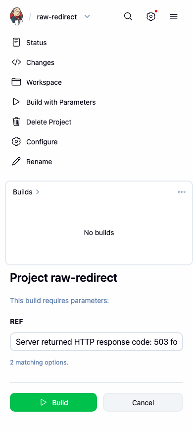](images/parameter-foundry/raw-rest-redirect-final-failure-mobile.png)

[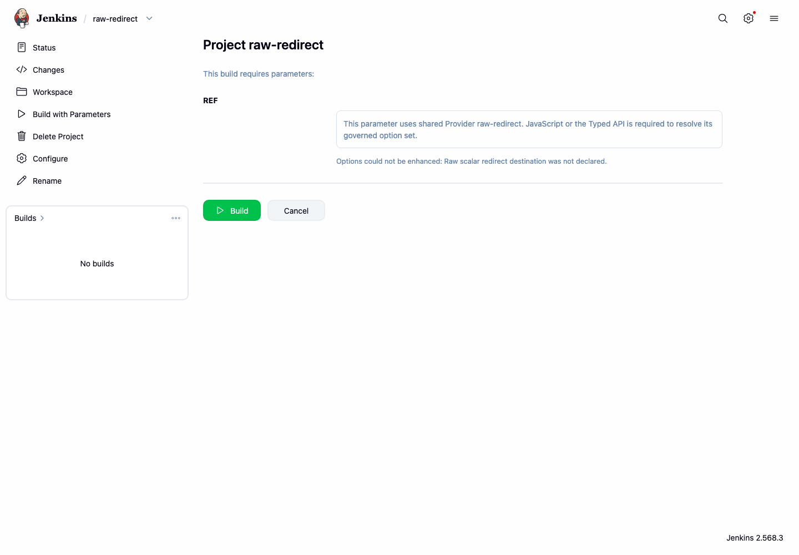](images/parameter-foundry/raw-rest-redirect-denied-desktop.png)

## Explicit nonredirect response bodies

Snapshot `0.25.376-SNAPSHOT`, Jenkins 2.568.3, Chromium 153:
[exact-artifact browser report](../testing/results/raw-rest-status-policy-ui-lab.json).
The actual global form changes the policy from its HTTP-status default and saves it.
Four status/default cases pass at 1440 and 390 pixels, with old mappings checked alongside.
Full Maven verification reports 539 tests, zero failures/errors and eight prerequisite skips.
No build is submitted. Configuration evidence uses the actual field viewport; oversized
full-page capture independently triggers Core's breadcrumb defect at a temporary 1×1 layout.
Dynamic resize, touch and assistive behavior are not certified by these captures.

[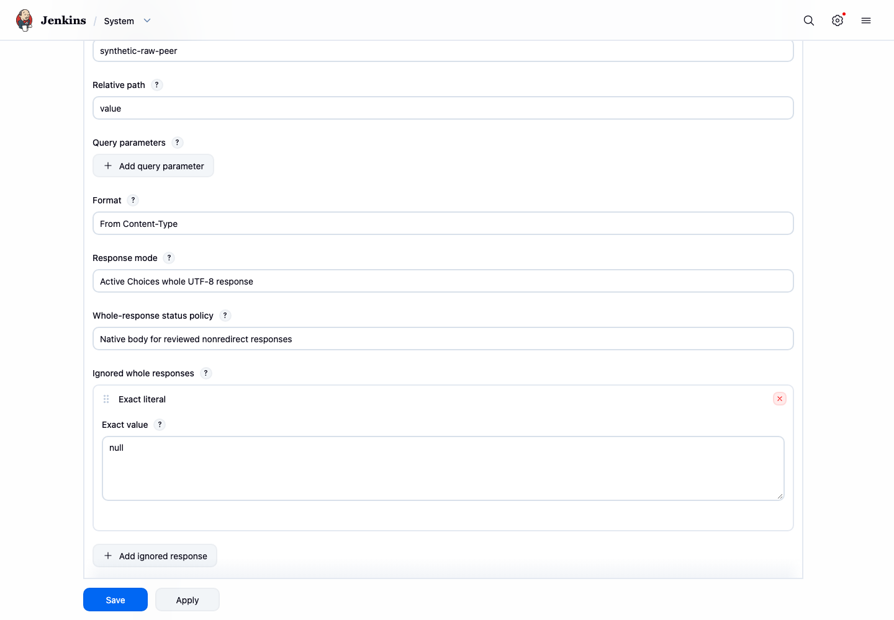](images/parameter-foundry/raw-rest-status-policy-config-desktop.png)

[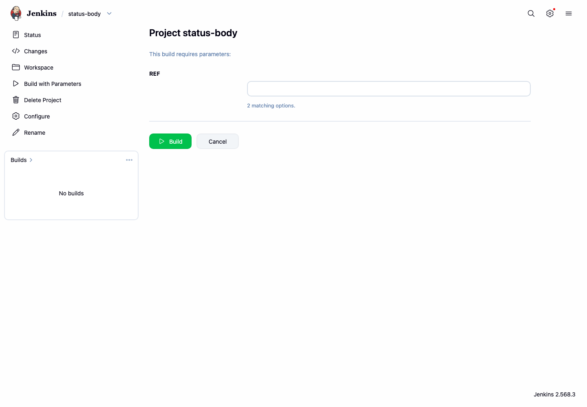](images/parameter-foundry/raw-rest-status-empty-desktop.png)

[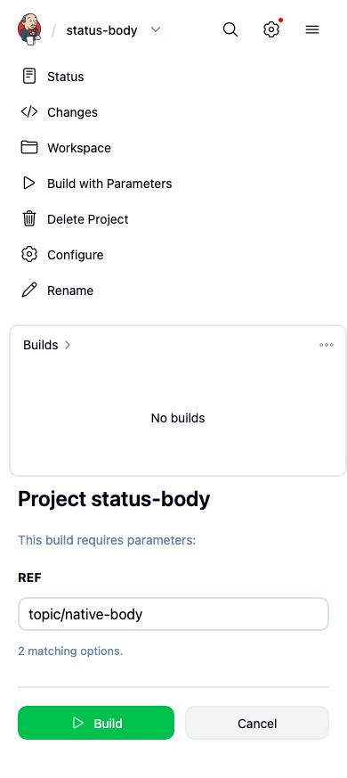](images/parameter-foundry/raw-rest-status-body-mobile.png)

## Declared DNS failures

Draft `0.24.373-SNAPSHOT`: [browser evidence](../testing/results/raw-rest-dns-ui-lab.json).
The desktop fixture preserves the Connection Profile while restoring only its
owned DNS name. Its JVM DNS caches are disabled explicitly for the test;
production DNS configuration is unchanged. Complete Maven verification passes
523 tests with zero failures/errors and six skips; the exact full-build HPI
passes the browser gate.

[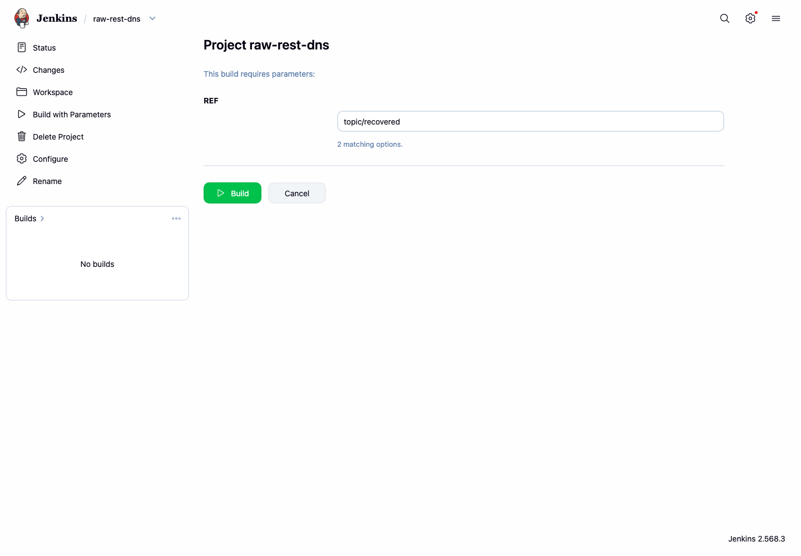](images/parameter-foundry/raw-rest-dns-recovered-desktop.png)

## Whole-response REST choices

Snapshot `0.23.371-SNAPSHOT`, Jenkins 2.568.3, Chromium 153. The
[browser report](../testing/results/raw-rest-provider-ui-lab.json) records exact
artifact and coverage. Body/default checks cover 1440 and 390 pixels; fallback,
recovery and native keyboard typeahead cover desktop only. No build submitted.

[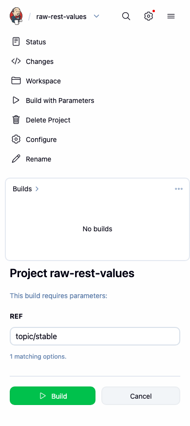](images/parameter-foundry/raw-rest-mobile.png)

[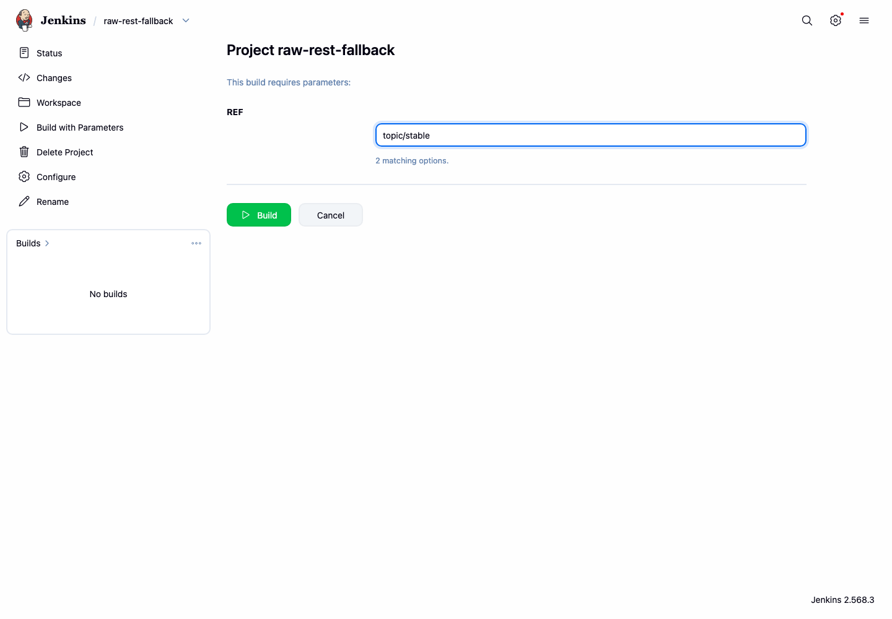](images/parameter-foundry/raw-rest-recovery-keyboard.png)

## Unified file delivery modes

Snapshot `0.5.274-SNAPSHOT`: [verification](../testing/file-delivery-modes-verification-2026-10-09.md)
and [browser report](../testing/results/foundry-file-modes-ui-lab.json).

[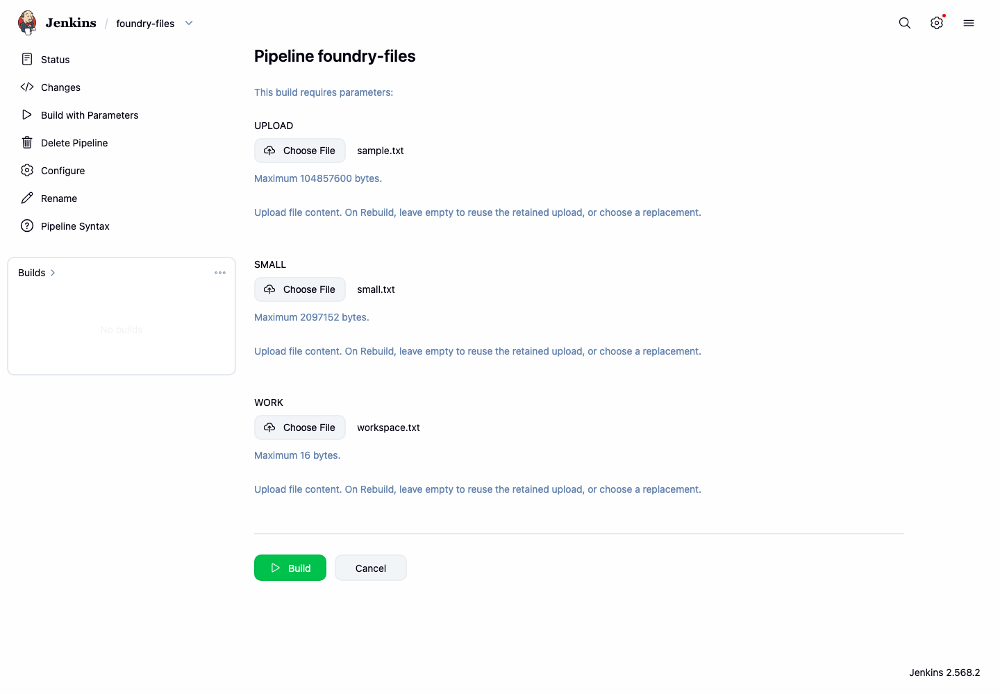](images/parameter-foundry/file-delivery-modes.png)

[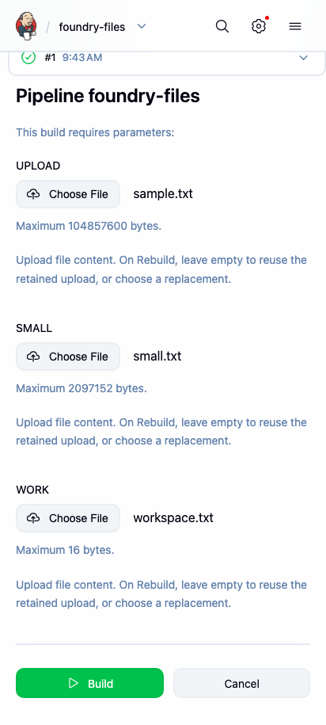](images/parameter-foundry/file-delivery-modes-mobile.png)

[Configuration](images/parameter-foundry/file-delivery-configuration.png) ·
[Core migration preview](images/parameter-foundry/core-file-migration-preview.png)

## Parameter Foundry file uploads

Generated on a disposable Jenkins 2.568.2 controller without File Parameters.
The [UI Lab report](../testing/results/foundry-files-ui-lab.json) records browser
and platform details, actual desktop/mobile submission, restart and Rebuild.

[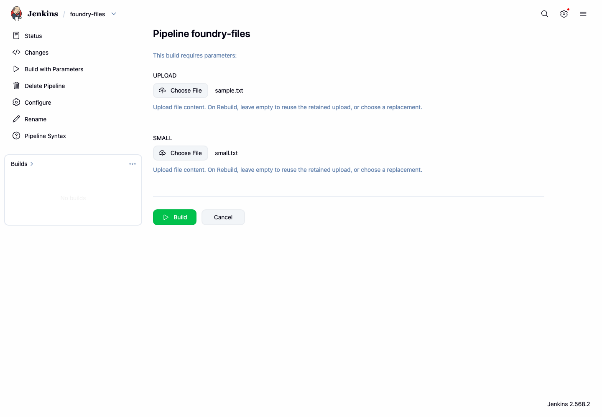](images/parameter-foundry/file-upload.png)

[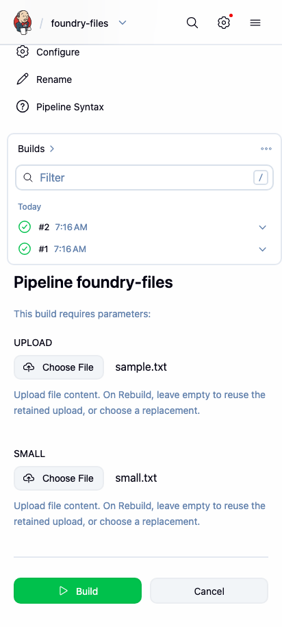](images/parameter-foundry/file-upload-mobile.png)

## Active Choices

`uno-choice:2.8.10` · Maintained

### Freestyle configuration

### Freestyle default state

### Freestyle user interaction

### Pipeline default state

### Pipeline Rebuild state

## Jenkins Core Parameters

`jenkins-core:2.568.2` · Core

### Freestyle configuration

### Freestyle default state

### Freestyle user interaction

### Pipeline default state

### Pipeline Rebuild state

## Custom Checkbox Parameter

`custom-checkbox-parameter:1.76.v08d845691023` · Security warning

### Freestyle configuration

### Freestyle default state

### Freestyle user interaction

### Pipeline default state

### Pipeline Rebuild state

## Editable Choice

`editable-choice:71.v02a291ebbe45` · Up for adoption

### Freestyle configuration

### Freestyle default state

### Freestyle user interaction

### Pipeline default state

### Pipeline Rebuild state

## Extended Choice Parameter

`extended-choice-parameter:388.ve7b_d0b_920e10` · Deprecated

### Freestyle configuration

### Freestyle default state

### Freestyle user interaction

### Pipeline default state

### Pipeline Rebuild state

## Extensible Choice Parameter

`extensible-choice-parameter:255.vfa_41f46828ef` · Up for adoption

### Freestyle configuration

### Freestyle default state

### Freestyle user interaction

### Pipeline default state

### Pipeline Rebuild state

## HTML Parameters

`html-parameters:10.v9a_56672a_96a_5` · Maintained

### Freestyle configuration

### Freestyle default state

### Freestyle user interaction

### Pipeline default state

### Pipeline Rebuild state

## Json Editor Parameter

`json-editor-parameter:54.v71962f37a_416` · Maintained

### Freestyle configuration

### Freestyle default state

### Freestyle user interaction

### Pipeline default state

### Pipeline Rebuild state

## JSON Parameter

`json-parameter:120.v3e5546f06794` · Maintained

### Freestyle configuration

### Reactive request in flight

### Freestyle default state

### Freestyle reactive update

### Pipeline default state

### Pipeline Rebuild state

## Multiselect Parameter

`multiselect-parameter:1.8` · Maintained

### Freestyle configuration

### Freestyle default state

### Freestyle user interaction

### Pipeline default state

### Pipeline Rebuild state

## REST List Parameter

`rest-list-parameter:362.v52147f86a_172` · Maintained

### Freestyle configuration

### Freestyle default state

### Freestyle user interaction

### Pipeline default state

### Pipeline Rebuild state

### Provider empty result

### Provider parsing error

## Validating String Parameter

`validating-string-parameter:345.v0f4330488a_f6` · Maintained

### Freestyle configuration

### Freestyle default state

### Freestyle validation error

### Pipeline default state

### Pipeline Rebuild state

## Parameter Foundry

`parameter-foundry:0.1-SNAPSHOT` · Target implementation

These screenshots are generated by `uv run tools/e2e/run-e2e.py` from the
current HPI on Jenkins `2.568.2-lts-jdk21`.

### Light theme build form

[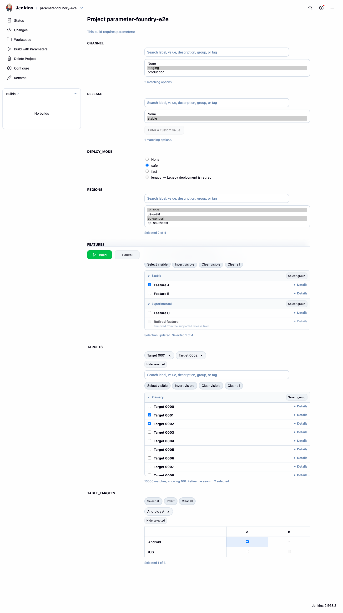](images/parameter-foundry/light.png)

### Dark Theme system mode

[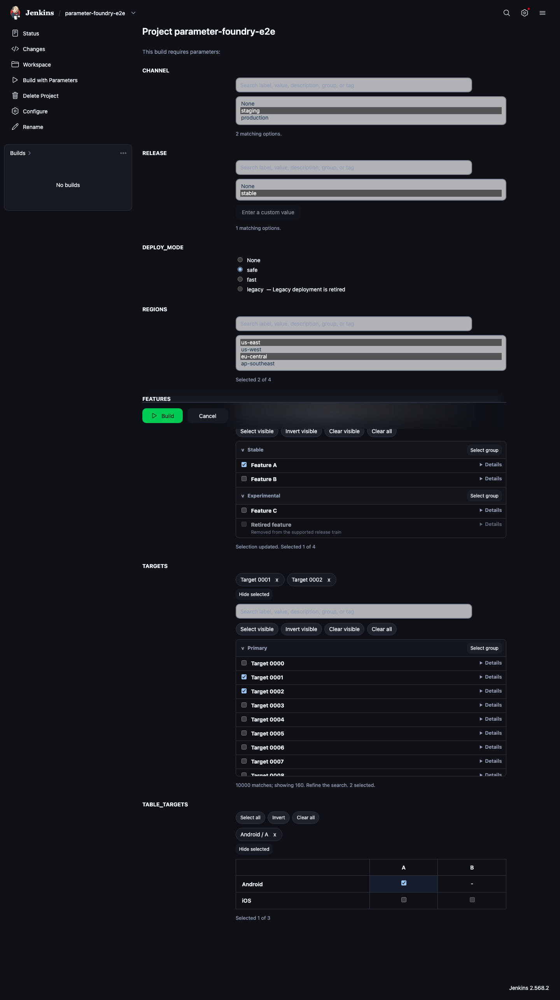](images/parameter-foundry/dark.png)

### Forced-colors high contrast

[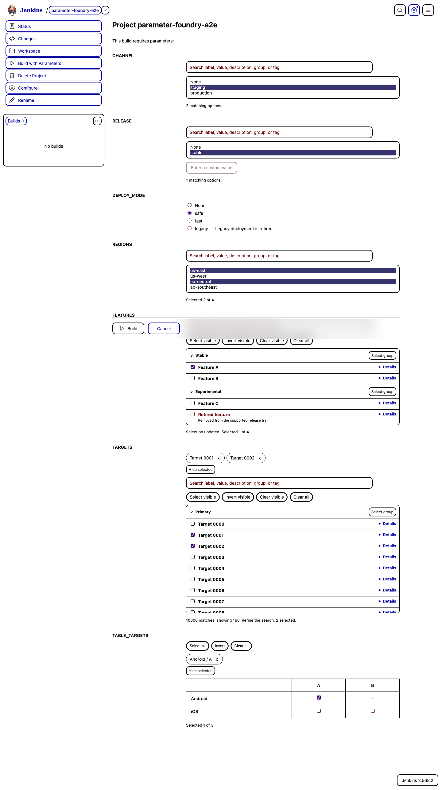](images/parameter-foundry/high-contrast.png)

### Keyboard focus and 10,000-option list

[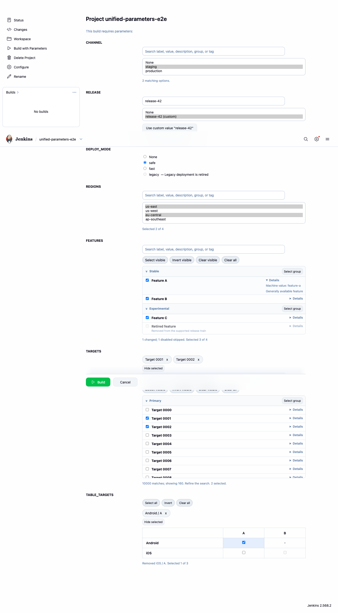](images/parameter-foundry/keyboard-focus.png)

### 390px responsive layout

[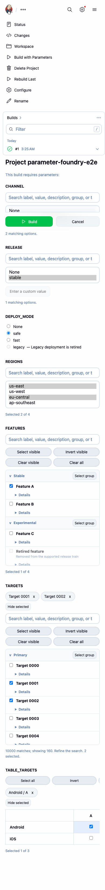](images/parameter-foundry/mobile.png)

### No-JavaScript fallback

[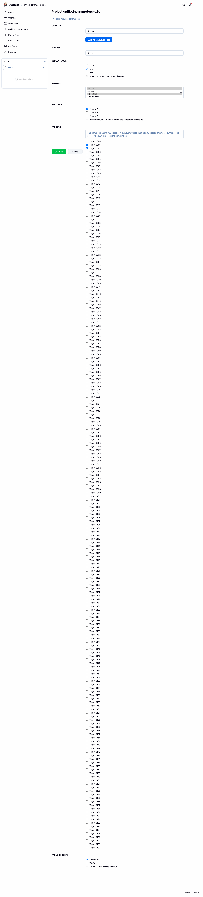](images/parameter-foundry/no-javascript.png)

### Configuration import preview

[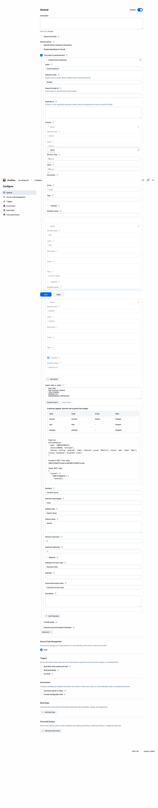](images/parameter-foundry/configuration-preview.png)

### Migration preview

[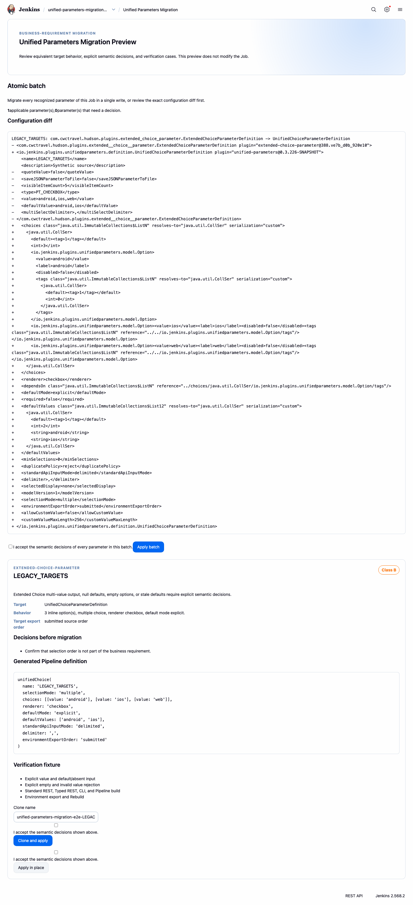](images/parameter-foundry/migration-preview.png)

### Foundry Form

[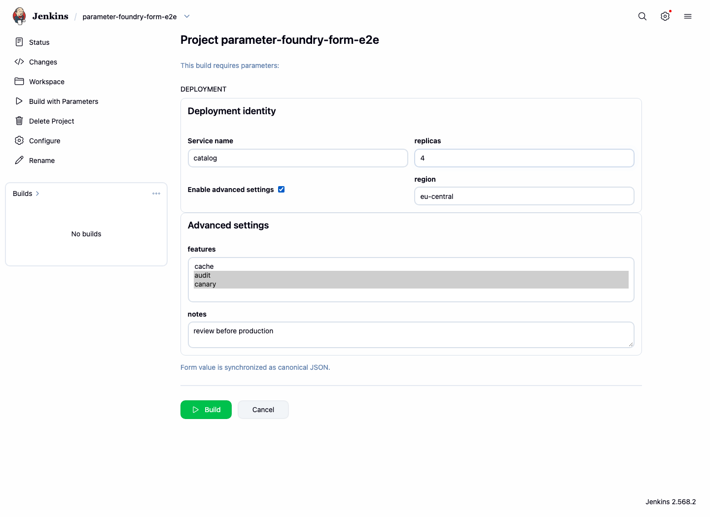](images/parameter-foundry/foundry-form.png)

### Source-plugin retirement dashboard

[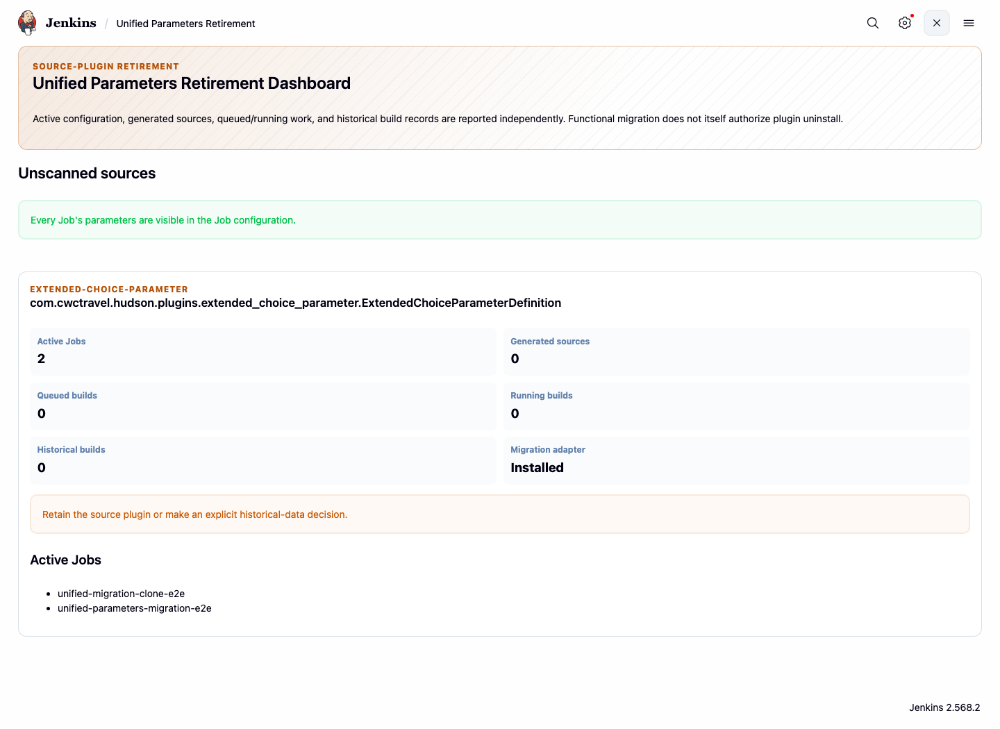](images/parameter-foundry/retirement-dashboard.png)

### Rebuild

[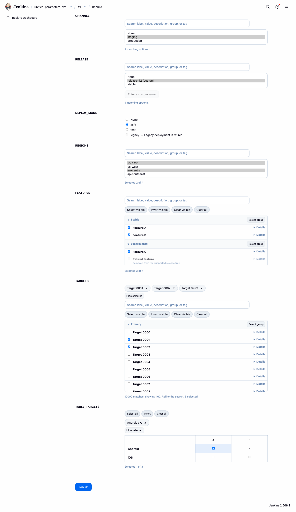](images/parameter-foundry/rebuild.png)

## Finite raw TLS declaration component (0.24.374-SNAPSHOT)

Exact complete-build HPI browser checks on Jenkins2.568.3/Java21, Chromium153,
macOS host, English UI; 1440×1000 and390×844 viewports. No builds submitted.

- [TLS declaration fields](./images/parameter-foundry/raw-rest-tls-fingerprint-configuration-desktop.png)
- [Declared TLS choice, desktop](./images/parameter-foundry/raw-rest-tls-declared-desktop.png)
- [Declared TLS choice, mobile](./images/parameter-foundry/raw-rest-tls-declared-mobile.png)
- [Unknown TLS refusal after scrolling, mobile](./images/parameter-foundry/raw-rest-tls-unknown-mobile.png)
- [Recovery after explicit valid-origin change](./images/parameter-foundry/raw-rest-tls-valid-origin-desktop.png)

Mobile Core sticky controls can initially overlap the final status; the error was
scrolled into view and hit-tested unobscured. A separate parameter-free Core Job
reproduces Jenkins2.568.3's long-name breadcrumb overflow exception. Product
fixtures use shorter names and retain strict pageerror checks. These checks do not
certify screen-reader/native-popup-arrow behavior or production migration.

## Legacy Git DEFAULT list selection (0.26.380-SNAPSHOT)

Real native List Git Branches76 and Foundry pages, Jenkins2.568.3/JDK21,
Chromium153.0.8010.12, macOS host. The literal API default is absent from
the offered options, so both lists remain unselected. Mobile captures are
scrolled and top/bottom hit-tested clear of Core's sticky buttons.

- [Native,1440x1000](./images/parameter-foundry/git-default-native-1440.png)
- [Foundry,1440x1000](./images/parameter-foundry/git-default-foundry-1440.png)
- [Native,390x844](./images/parameter-foundry/git-default-native-390.png)
- [Foundry,390x844](./images/parameter-foundry/git-default-foundry-390.png)

[UP-AC-077 evidence](../testing/results/git-default-list-native-ui-lab.json)
records30paired UI cases and42captured/detached form pairs. No production
repository or credentials are used. Physical-device and screen-reader testing
remain separate. The long-name Core breadcrumb control is not a product pass.
